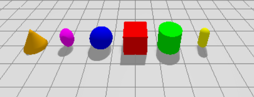
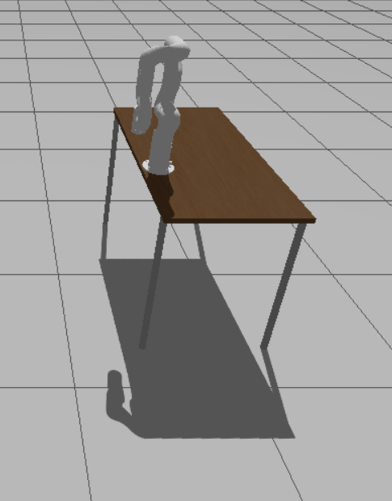
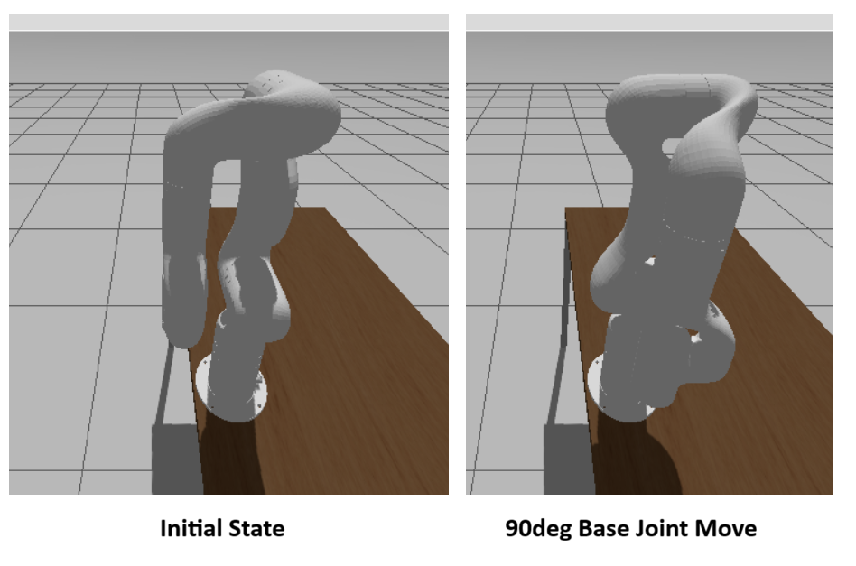

# Gazebo Usage

These usage docs follow Gazebo's docs [Getting Started with Gazebo](https://gazebosim.org/docs/harmonic/getstarted/).

1. **Start Gazebo with a demo world**

    `gz sim shapes.sdf`

    You should see a world with different shapes. Close when done.

    - left click & drag for pan
    - shift left click & drag for orbig
    - scroll wheel for zoom

    

2. **Run UFactory 850 ROS Gazebo File**

    Launch the ros demo to see a UF850 on a table.

    ```
    cd ~/xarm_ws
    source install/setup.bash
    ros2 launch xarm_gazebo uf850_beside_table_gazebo.launch.py
    ```


    

**To Start Robot Controller**

The above launch file doesn't start the robot controller. There are small changes needed to the launch files to make this work:

uf850_beside_table_gazebo.launch.py

after add_vacuum_gripper in generate_launch_description():

`load_controller = LaunchConfiguration('load_controller', default=False)`

after add_vacuum_gripper in launch_arguments:

`'load_controller': load_controller,`

change return to:

```
return LaunchDescription([
    DeclareLaunchArgument(
        'load_controller',
        default_value='false',
        description='Load ros2_control controllers'
    ),
    robot_gazobo_launch
])
```

run like this:

`ros2 launch xarm_gazebo uf850_beside_table_gazebo.launch.py load_controller:=true`

you will see:

```
ros2 topic list
/clock
/controller_manager/activity
/controller_manager/introspection_data/full
/controller_manager/introspection_data/names
/controller_manager/introspection_data/values
/controller_manager/statistics/full
/controller_manager/statistics/names
/controller_manager/statistics/values
/diagnostics
/dynamic_joint_states
/joint_state_broadcaster/transition_event
/joint_states
/parameter_events
/robot_description
/rosout
/tf
/tf_static
/uf850_traj_controller/controller_state
/uf850_traj_controller/joint_trajectory
/uf850_traj_controller/transition_event

ros2 action list
/uf850_traj_controller/follow_joint_trajectory
```

**Move Robot base joint 90deg**
```
ros2 action send_goal /uf850_traj_controller/follow_joint_trajectory control_msgs/action/FollowJointTrajectory "{
  trajectory: {
    joint_names: [joint1, joint2, joint3, joint4, joint5, joint6],
    points: [
      {
        positions: [1.5708, 0.0, 0.0, 0.0, 0.0, 0.0],
        time_from_start: {sec: 5}
      }
    ]
  }
}" --feedback
```

