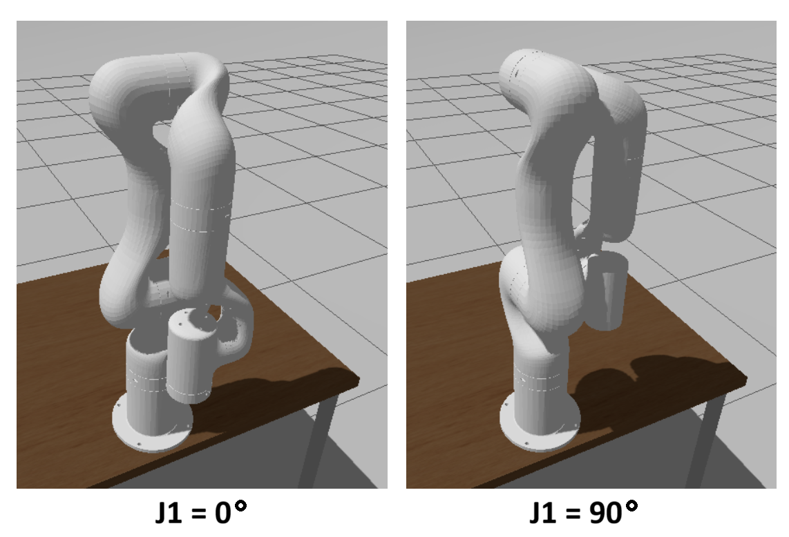

# ROB545 Final Project Journal

**10/26/2026** Bryan

Two problems to resolve:

1. How to create a block in Gazebo and move it with a pre-defined trajectory

2. How to implement **mode 7** redirectable trajectory move compatible with real UFactory-850 controller's api and implementing equivalent behavior

**mode 7** simulation:

ChatGPT suggested [ruckig](https://github.com/pantor/ruckig?utm_source=chatgpt.com) as an existing motion planning software. It is based on the paper [Jerk-limited Real-time Trajectory Generation with Arbitrary Target States](Jerk-limited_Real-time_Trajectory_Generation_(ruckig).pdf). Apparently the gazebo simulation of UF850 includes ability to set its joints and apparently publishes current position, perhaps in the same way the real controller does, I haven't looked. I haven't investigated **ruckig** yet other than to copy their paper and post the GitHub link. I think we would create a simulated controller ROS node that has the equivalent api for **mode 7** move as the real UF850 controller. When given a new target, it would give it to the **ruckig** algorithm, which continuously provides new joint outputs. Somehow any differences between where the simulation goes and what **ruckig** is thinking needs to be fed back into it. 

Another alternative ChatGPT suggested was to use the **MoveIt!** package. I didn't investigate further down this path yet.

I learned that **ruckig** is used in **MoveIt!** for trajectory planning. So it's basically a tradeoff of what layer we want to interface with - use **ruckig** directly or learn **MoveIt!**. ChatGPT suggests that direct use of **ruckig** may be a good alternative. 

One thing to handle properly is rotation. **ruckig** is a cartesian trajectory planner. I am familiar with Universal Robots which uses the "axis-angle" way of representing rotations, which is the same as the exponential method we learned in ROB-545. If a trajectory's orientation can be described as a rotation along an axis angle, then this can be interpolated linearly and **ruckig** could be used directly for this, with care to adjust the parameters to represent angular velocity and acceleration maxima. An alternative is to use **quaternions** to specify the orientation and use **SLERP** (spherical linear interpolation) and have **ruckig** compute the interpolation factor between the two quaternions, which is between 0 and 1 and adjust angular and velocity scaling as needed. The difficulty with both of these, I think, is how to handle rotations in progress when a new trajectory is updated. 

ChatGPT recommends we look at what's provided with the UF850 Gazebo simulator as input. Is it just joint angles are is more of the UF850 controller implemented somehow? Maybe **mode 7** is already implemented.

I am reading the **ruckig** repo docs and the paper to understand how all of it works.

**10/30/2026**

Figured out that there is a motion controller for the UF850 gazebo sim, it was just turned off. I needed to fix the launch script a little in order to allow a parameter to be passed through, but then it worked and I can specify a goal position and the robot moves there. 

**TODO**

- Figure out whether `mode 7` is supported.
- Incorporate whatever custom files are needed in this repo.

**10/30/2026**

`mode 7` is not supported. The simulator provides a joint trajectory controller. I think we need to implement our own cartesian online trajectory controller using **ruckig** and inverse kinematics to get to joint space. We need to handle orientation properly. Still working with ChatGPT to understand what needs to be done. The controller I enabled to move the robot may be too elaborate for raw servoing commands. There may be another path that makes sense.

**11/3/2026**

Explaining more detail about how I got the UF850 in Gazebo to move on 10/29/2026. To remember how I did it, I have a lot of detail here. Done on my Linux machine `192.168.0.34` where I've cloned this stuff. In my personal copy of `xarm_ws` there is directory `src/xarm_ros2/xarm_gazebo/launch`. In there is `uf850_beside_table_gazebo.launch.py`. Some small edits were done with the advice of ChatGPT to pass the parameter `load_controller` throught the launch files. It is started with
```
cd ~/xarm_ws
source install/setup.bash
ros2 launch xarm_gazebo uf850_beside_table_gazebo.launch.py load_controller:=true
```
Here is the list of topics that are available:
```
/clock
/controller_manager/activity
/controller_manager/introspection_data/full
/controller_manager/introspection_data/names
/controller_manager/introspection_data/values
/controller_manager/statistics/full
/controller_manager/statistics/names
/controller_manager/statistics/values
/diagnostics
/dynamic_joint_states
/joint_state_broadcaster/transition_event
/joint_states
/parameter_events
/robot_description
/rosout
/tf
/tf_static
/uf850_traj_controller/controller_state
/uf850_traj_controller/joint_trajectory
/uf850_traj_controller/transition_event
```
This is apparently what we want `/uf850_traj_controller`. 

Send this message to rotate base joint 90deg:
```
ros2 action send_goal /uf850_traj_controller/follow_joint_trajectory control_msgs/action/FollowJointTrajectory "{
  trajectory: {
    joint_names: [joint1, joint2, joint3, joint4, joint5, joint6],
    points: [
      {
        positions: [1.5708, 0.0, 0.0, 0.0, 0.0, 0.0],
        time_from_start: {sec: 5}
      }
    ]
  }
}" --feedback
```
Send this message to send base joint back to 0deg:
```
ros2 action send_goal /uf850_traj_controller/follow_joint_trajectory control_msgs/action/FollowJointTrajectory "{
  trajectory: {
    joint_names: [joint1, joint2, joint3, joint4, joint5, joint6],
    points: [
      {
        positions: [0, 0.0, 0.0, 0.0, 0.0, 0.0],
        time_from_start: {sec: 5}
      }
    ]
  }
}" --feedback
```
I'm not sure the `uf850_traj_contrller/follow_joint_trajectory` is exactly what we want to use, but it's the first thing that worked.



<video src="images/UF850-90deg.mp4" controls width="640" height="360"></video>

