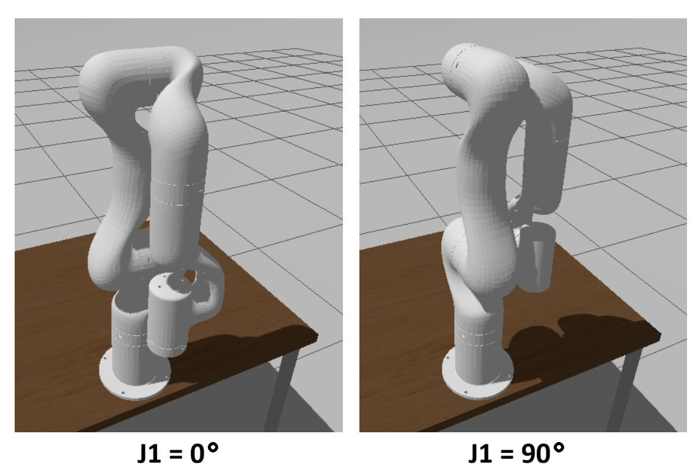

# ROB545 Final Project Journal

**10/26/2026** Bryan

Two problems to resolve:

1. How to create a block in Gazebo and move it with a pre-defined trajectory

2. How to implement **mode 7** redirectable trajectory move compatible with real UFactory-850 controller's api and implementing equivalent behavior

**mode 7** simulation:

ChatGPT suggested [ruckig](https://github.com/pantor/ruckig?utm_source=chatgpt.com) as an existing motion planning software. It is based on the paper [Jerk-limited Real-time Trajectory Generation with Arbitrary Target States](Jerk-limited_Real-time_Trajectory_Generation_(ruckig).pdf). Apparently the gazebo simulation of UF850 includes ability to set its joints and apparently publishes current position, perhaps in the same way the real controller does, I haven't looked. I haven't investigated **ruckig** yet other than to copy their paper and post the GitHub link. I think we would create a simulated controller ROS node that has the equivalent api for **mode 7** move as the real UF850 controller. When given a new target, it would give it to the **ruckig** algorithm, which continuously provides new joint outputs. Somehow any differences between where the simulation goes and what **ruckig** is thinking needs to be fed back into it. 

Another alternative ChatGPT suggested was to use the **MoveIt!** package. I didn't investigate further down this path yet.

I learned that **ruckig** is used in **MoveIt!** for trajectory planning. So it's basically a tradeoff of what layer we want to interface with - use **ruckig** directly or learn **MoveIt!**. ChatGPT suggests that direct use of **ruckig** may be a good alternative. 

One thing to handle properly is rotation. **ruckig** is a cartesian trajectory planner. I am familiar with Universal Robots which uses the "axis-angle" way of representing rotations, which is the same as the exponential method we learned in ROB-545. If a trajectory's orientation can be described as a rotation along an axis angle, then this can be interpolated linearly and **ruckig** could be used directly for this, with care to adjust the parameters to represent angular velocity and acceleration maxima. An alternative is to use **quaternions** to specify the orientation and use **SLERP** (spherical linear interpolation) and have **ruckig** compute the interpolation factor between the two quaternions, which is between 0 and 1 and adjust angular and velocity scaling as needed. The difficulty with both of these, I think, is how to handle rotations in progress when a new trajectory is updated. 

ChatGPT recommends we look at what's provided with the UF850 Gazebo simulator as input. Is it just joint angles are is more of the UF850 controller implemented somehow? Maybe **mode 7** is already implemented.

I am reading the **ruckig** repo docs and the paper to understand how all of it works.

### 10/27/2026 Nabin

Gazebo block creation and predefined trajectory

I successfully created and spawned a block in the UF850 Gazebo simulation using ROS 2 Jazzy and Gazebo Harmonic. The block was defined using an SDF model and spawned into the existing /world/default environment containing the UF850 robot and table.

I verified that the block could be moved by calling Gazebo's /world/default/set_pose service. The service returned data: true, and the block visibly changed position.

I then developed a Python script (move_block.py) to move the block automatically along a predefined sinusoidal trajectory on the X-axis. The block moves back and forth between approximately 0.5 m and 0.6 m, with a nominal trajectory period of 8 seconds.

Results:

Block creation and spawning were successful.

Manual position control through the Gazebo service worked.

The Python script successfully produced continuous back-and-forth movement.

Gazebo remained responsive during the test.

The movement was moderately smooth, with some visible discontinuities.

Current limitations and next steps:

The Python script currently uses repeated gz service calls through subprocesses to update the block's position. This introduces overhead and may contribute to uneven movement.

I confirmed that the ROS 2 ros_gz_interfaces/srv/SetEntityPose interface is installed. The next step is to test communication through ros_gz_bridge and implement a ROS 2 Python node for more efficient trajectory updates.

This work addresses the initial moving-object simulation problem. Camera integration, PBVS, and UF850 tracking control have not yet been implemented.

**10/30/2026**

Figured out that there is a motion controller for the UF850 gazebo sim, it was just turned off. I needed to fix the launch script a little in order to allow a parameter to be passed through, but then it worked and I can specify a goal position and the robot moves there. 

**TODO**

- Figure out whether `mode 7` is supported.
- Incorporate whatever custom files are needed in this repo.

**10/30/2026**

`mode 7` is not supported. The simulator provides a joint trajectory controller. I think we need to implement our own cartesian online trajectory controller using **ruckig** and inverse kinematics to get to joint space. We need to handle orientation properly. Still working with ChatGPT to understand what needs to be done. The controller I enabled to move the robot may be too elaborate for raw servoing commands. There may be another path that makes sense.

**11/3/2026**

Explaining more detail about how I got the UF850 in Gazebo to move on 10/29/2026. To remember how I did it, I have a lot of detail here. Done on my Linux machine `192.168.0.34` where I've cloned this stuff. In my personal copy of `xarm_ws` there is directory `src/xarm_ros2/xarm_gazebo/launch`. In there is `uf850_beside_table_gazebo.launch.py`. Some small edits were done with the advice of ChatGPT to pass the parameter `load_controller` throught the launch files. It is started with
```
cd ~/xarm_ws
source install/setup.bash
ros2 launch xarm_gazebo uf850_beside_table_gazebo.launch.py load_controller:=true
```
Here is the list of topics that are available:
```
/clock
/controller_manager/activity
/controller_manager/introspection_data/full
/controller_manager/introspection_data/names
/controller_manager/introspection_data/values
/controller_manager/statistics/full
/controller_manager/statistics/names
/controller_manager/statistics/values
/diagnostics
/dynamic_joint_states
/joint_state_broadcaster/transition_event
/joint_states
/parameter_events
/robot_description
/rosout
/tf
/tf_static
/uf850_traj_controller/controller_state
/uf850_traj_controller/joint_trajectory
/uf850_traj_controller/transition_event
```
This is apparently what we want `/uf850_traj_controller`. 

Send this message to rotate base joint 90deg:
```
ros2 action send_goal /uf850_traj_controller/follow_joint_trajectory control_msgs/action/FollowJointTrajectory "{
  trajectory: {
    joint_names: [joint1, joint2, joint3, joint4, joint5, joint6],
    points: [
      {
        positions: [1.5708, 0.0, 0.0, 0.0, 0.0, 0.0],
        time_from_start: {sec: 5}
      }
    ]
  }
}" --feedback
```
Send this message to send base joint back to 0deg:
```
ros2 action send_goal /uf850_traj_controller/follow_joint_trajectory control_msgs/action/FollowJointTrajectory "{
  trajectory: {
    joint_names: [joint1, joint2, joint3, joint4, joint5, joint6],
    points: [
      {
        positions: [0, 0.0, 0.0, 0.0, 0.0, 0.0],
        time_from_start: {sec: 5}
      }
    ]
  }
}" --feedback
```
I'm not sure the `uf850_traj_contrller/follow_joint_trajectory` is exactly what we want to use, but it's the first thing that worked.



<video src="images/UF850-90deg.mp4" controls width="640" height="360"></video>

**11/13/2026**

I've been working for several days to understand ROS related to robot drivers. Beyond the ROB-545 class, I want to have a unified way of talking to robots in ROS to implement various use cases, including visual servoing.

I spent quite a while looking at the Universal Robots ROS driver, which is the most complete in the industry. Then I looked at the UF850 real robot ROS driver and the UF850 Gazebo ROS driver. They provided different topics. Then I realized that Universal Robots has a single driver but UFactory has several pieces of their ROS driver that can be separately enabled. So I think for the real and simulated robot I had different pieces enabled. I will investigate further. 

Furthermore, PBVS is a feedback loop that takes measured position of the target compared to desired position and uses this error to drive a velocity vector output to the robot. So the control to the robot is velocity not position. When the robot achieves the target location, the velocity becomes zero. This implies that a velocity controller is required, not a position controller. UF850 mode 7 is redirectable position control. Mode 5 might be redirectable velocity control. I will investigate further.

For use in a deployed real robot, it is preferred to have trajectory generation occur on-robot instead of streaming a trajectory over the network. However, it appears that the general ROS robot drivers use streaming trajectories and indicate the requirement for real-time OS kernels. 

**PBVS Algorithm**

In reading Corke *Visual Control of Robots* section 6.4 *Visual Feedback Control* the act of visual servoing could be implemented in two ways. First, a redirectable position trajectory generator could be used (similar to UFactory mode 7), but this is described as potentially needlessly complicated. Instead the problem can be reframed as a control problem. The perceived position error generates a velocity demand which moves the robot toward the target. He says "This results automatically in target following behaviour, but without the complexities of an explicit trajectory generator." This is basically *steering*.

Section 7.1 formulates the control equations for visual servoing. Position error is treated as a velocity and is integrated to yield position. For a still object (step function movement), tracking error becomes zero. For a constant speed object (ramp movement), there is a steady tracking error (lag). The end of section 7.1 describes feedforward as a viable solution to this problem.

Section 7.5 discusses feedforward control, which is what we desire for our project, shown in Figure 7.20 or perhaps instead Figure 7.21.

**Establishing Velocity Control Mode**

On the real robot, I tested whether the robot could move in velocity mode (mode 5). 

```
ros2 service call /ufactory/set_mode xarm_msgs/srv/SetInt16 "{data: 5}"
ros2 service call /ufactory/set_state xarm_msgs/srv/SetInt16 "{data: 0}"
ros2 topic echo /ufactory/robot_states --once
```
This confirms it went into mode 5 (velocity mode). State = 1, which normally means motion. Perhaps in velocity mode it means it's actively controlling the robot "moving" but at velocity = 0.

Here is the first velocity test:
```
ros2 service call /ufactory/vc_set_cartesian_velocity xarm_msgs/srv/MoveVelocity \
"{speeds: [0, 0, 5, 0, 0, 0], is_tool_coord: false, duration: 0.5}"
```
It moved slowly upward as expected. now for something a little faster:
```
ros2 service call /ufactory/vc_set_cartesian_velocity xarm_msgs/srv/MoveVelocity \
"{speeds: [0, 0, 10, 0, 0, 0], is_tool_coord: false, duration: 2.0}"
```
That worked. Then I put it back into mode 0 (normal moves):
```
ros2 service call /ufactory/set_mode xarm_msgs/srv/SetInt16 "{data: 0}"
ros2 service call /ufactory/set_state xarm_msgs/srv/SetInt16 "{data: 0}"
```
This confirms that the ROS driver on the real robot can implement mode 5 (velocity control). Next step is to see if that can be done in the simulation.

**Gazebo simulation with velocity control**

It seems that the Gazebo sim with moveit_servo might be the closest thing in the UFactory repo to what we need. It is designed to use a keyboard to jog the simulated robot around.

Built the xarm_moveit_servo with colcon. Started things like this:
```
ros2 launch xarm_moveit_config uf850_moveit_gazebo.launch.py
ros2 launch xarm_moveit_servo uf850_moveit_servo_gazebo.launch.py
ros2 service call /servo_server/switch_command_type moveit_msgs/srv/ServoCommandType "{command_type: 1}"
```

Worked a long time with ChatGPT but never got this to work. Here is what we are trying to accomplish:

### UF850 Gazebo: MoveIt Servo Cartesian Velocity Control

**Objective**

Get `xarm_moveit_servo` working with the UF850 Gazebo simulation so that we can send Cartesian velocity (`TwistStamped`) commands and move the simulated robot in Cartesian space.

This is intended to provide a simulation equivalent to the Cartesian velocity control we previously tested on the real UF850 using UFactory Mode 5.

### Real Robot vs. Simulation

On the real robot, Mode 5 accepts a six-element Cartesian velocity command:

`[vx, vy, vz, wx, wy, wz]`

Linear velocities are in mm/s and angular velocities in rad/s. The UFactory controller handles the inverse kinematics and joint motion internally.

In simulation, MoveIt Servo provides the corresponding functionality. It accepts Cartesian Twist commands, calculates joint commands using the robot model, and sends them to the Gazebo trajectory controller. Servo also provides smoothing, joint-limit handling, singularity handling, and collision checking.

### Work Completed

1. Established a working UF850 Gazebo and MoveIt environment using `uf850_beside_table_gazebo.launch.py`.
2. Verified that MoveIt planning and Plan and Execute successfully move the robot in both RViz and Gazebo.
3. Integrated a Servo node into the Gazebo MoveIt launch configuration.
4. Configured Servo for the UF850 planning group and the `/uf850_traj_controller/joint_trajectory` output topic.
5. Verified that Servo starts and subscribes to:
   - `/servo_server/delta_twist_cmds`
   - `/joint_states`
   - `/planning_scene`
6. Created `/tmp/test_servo.py` to publish timestamped Cartesian Twist commands after Gazebo simulation time starts advancing.
7. Verified that Twist messages reach Servo and that Servo reports no warnings.

### Current Status

**MoveIt planning works, but Cartesian Servo motion is not yet working.**

The test Twist commands reach Servo, and Servo is connected to the robot-state and planning-scene topics. However, no joint trajectory is observed on `/uf850_traj_controller/joint_trajectory`, and the robot does not move.

One unresolved issue is that some frame parameters appear in the generated ROS launch parameter files but were not visible in runtime parameter queries. This needs further investigation.

### Files Modified

In `~/xarm_ws/src/xarm_ros2`:

- `xarm_gazebo/launch/uf850_beside_table_gazebo.launch.py`
- `xarm_moveit_config/launch/_robot_moveit_gazebo.launch.py`
- `xarm_moveit_servo/launch/uf850_moveit_servo_gazebo.launch.py` (new)

These changes are local and have not been committed to the upstream xArm repository.

The test publisher was saved from `/tmp/test_servo.py` to `~/xarm_ws/test_scripts/test_servo.py`.

### Next Steps

Investigate why Servo receives Cartesian commands and has access to the robot state and planning scene, but does not generate joint trajectories. Pay particular attention to its runtime frame configuration and command-processing path.

Once Servo produces motion in Gazebo, test Cartesian translation and rotation commands and compare the behavior with the real UF850 Mode 5 interface.

**11/14/2026**

Working through the following todo list. Will check off as they get completed.

- [x]	Create the correct directory structure for implementing custom ROS code and launch files outside of the xarm repo.

- [x] Move custom work that I’ve done into this new spot and clean up my xarm repo (or re clone it) so that it is pristine.

- [x] Continue working with Codex to get xarm_moveit_servo to work which takes a twist (velocity) command to move the gazebo robot.

- [x] Fix test_servo.py test program that moves using twist commands.

- [x] Start robot above the table, away from singularities. I rotated the robot 180 degrees to ensure the joints were within limits when it is moving around the table.

- [x]	Create a simple Python test program where I can specify a joint target and it commands twists and reads current joint position to move to that target.

- [x]	Assume the joint target qt = (theta1, theta2, …, theta6) the 6 joints of the robot. Assume current values of the joints are q. Assume we command the robot using a twist qdot = (d/dt theta1, d/dt theta2, …, d/dt theta3) with xarm_moveit_servo. A simple control algorithm is qdot = K (qt – q).

**Running the Simulation**

Do this once in each new window to load script paths
```
cd ~/xarm_ws
source install/setup.bash
```

Start simulation:
```
ros2 launch rob545_bringup uf850_moveit_gazebo.launch.py
```

Start test program that does cartesian servoing to a point on the table:
```
python3 src/ROB545/rob545_bringup/scripts/cartesian_point_servo.py
```

**Short video of servoing to a point**

