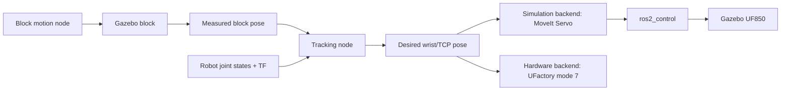

# UF850 Visual Servoing in Gazebo

Codex was asked to suggest how to implement visual servoing of a simulated UFactory-850 robot in Gazebo. The suggestions include implementing this in simulation and on a real UFactory-850 robot.

## Proposed approach

You can build this with the existing ROS 2 Jazzy/Gazebo setup. **Separate the tracking algorithm from the robot control backend**, because Gazebo does not run UFactory's mode 7 firmware.

The four referenced files were reviewed. `sandbox/redirect.py` already demonstrates the hardware behavior: switch to mode 7 and issue a new Cartesian destination while the previous move is running. UFactory's example confirms that each new command interrupts the current move in this mode.

Source: [UFactory mode 7 example](https://github.com/xArm-Developer/xArm-Python-SDK/blob/master/example/wrapper/common/1010-cartesian_online_trajectory_planning.py).

### 1. Architecture



The tracking node receives:

- Block pose as `geometry_msgs/PoseStamped`.
- Actual wrist or TCP pose from TF, calculated from measured joint states.
- Optionally, estimated block velocity.

It publishes a desired TCP pose in the robot base frame. Separate backends translate this into simulation or hardware commands.

Initially this is **ground-truth pose tracking**. Replacing the Gazebo block pose with a camera-derived pose makes it position-based visual servoing.

### 2. Gazebo and mode 7 boundary

The upstream Gazebo launch uses `gz_ros2_control/GazeboSimSystem` and a joint trajectory controller. It does not launch a virtual UFactory controller accepting the driver's mode 7 commands. Launching `uf850_driver.launch.py` therefore does not connect that driver to the Gazebo robot.

Source: [UFactory Gazebo launch source](https://github.com/xArm-Developer/xarm_ros2/blob/jazzy/xarm_gazebo/launch/_robot_beside_table_gazebo.launch.py).

| Goal | Approach |
| --- | --- |
| Develop and test block tracking | Use MoveIt Servo to control the Gazebo UF850 |
| Keep the UFactory service interface in simulation | Write an adapter accepting `set_mode`, `set_state`, and `set_position`, translating targets into simulated joint motion |

Start with MoveIt Servo. An adapter's mode 7 behavior would be an approximation; it would not reproduce the proprietary controller's trajectory generation and timing.

MoveIt Servo supports Cartesian control and converts it into joint commands, with facilities for singularity checking, collision checking, and joint limits. Configure the interfaces supported by the installed Jazzy version.

Source: [MoveIt Servo documentation](https://moveit.picknik.ai/main/doc/examples/realtime_servo/realtime_servo_tutorial.html).

### 3. Moving rectangular block

Create a package such as `uf850_tracking`:

```text
uf850_tracking/
  launch/tracking_sim.launch.py
  worlds/tracking.world.sdf
  models/tracking_block/model.sdf
  config/tracking.yaml
  target_motion.py
  target_pose_bridge.py
  tracking_node.py
  hardware_mode7_backend.py
```

Start with a box approximately `0.12 x 0.06 x 0.04 m`, in the robot's reachable workspace above the table.

For the initial experiment, prescribe the block motion without requiring realistic conveyor or contact dynamics. The motion node can set its pose through Gazebo's `/world/<world_name>/set_pose` service when the world loads the `UserCommands` system. Use Gazebo Transport or an appropriate ROS bridge; this is not automatically a ROS service.

Source: [Gazebo UserCommands](https://gazebosim.org/api/sim/8/classgz_1_1sim_1_1systems_1_1UserCommands.html).

Example parameters:

```yaml
motion: circle             # stationary, line, circle
center: [0.0, 0.0, 0.0]     # replace with actual world coordinates
radius: 0.05
period: 10.0
line_amplitude: 0.05
```

Circle:

```text
x(t) = cx + r cos(omega t)
y(t) = cy + r sin(omega t)
z(t) = constant
omega = 2 pi / period
```

Smooth back-and-forth motion along a straight line:

```text
p(t) = center + direction * amplitude * sin(omega t)
```

This follows a straight line with smoothly varying speed. Use a trapezoidal velocity profile for constant-speed sections.

**Feed the tracker the actual Gazebo block pose**, rather than reusing the commanded trajectory. Gazebo's `PosePublisher` can supply model poses for a bridge/normalization node that produces `PoseStamped` messages.

Source: [Gazebo PosePublisher](https://gazebosim.org/api/sim/8/classgz_1_1sim_1_1systems_1_1PosePublisher.html).

### 4. Coordinate frames

Use a frame tree along these lines, confirming actual link names in the UF850 URDF:

```text
world
 |-- robot_base
 |    `-- ... robot links ... -- wrist -- tracking_tcp
 `-- tracking_block
```

The upstream Gazebo demo spawns the UF850 translated and rotated relative to the world. Do not send block world coordinates directly as robot base-frame coordinates. Verify that TF correctly represents the spawn transform.

Source: [Gazebo spawn configuration](https://github.com/xArm-Developer/xarm_ros2/blob/jazzy/xarm_gazebo/launch/_robot_beside_table_gazebo.launch.py).

Define "right on top" as:

- TCP horizontally centered over the block.
- TCP a configurable distance above the top surface.
- Fixed downward-facing tool orientation initially.

For a level block whose pose is at its center:

```text
desired_world_position =
    block_center + [0, 0, block_height/2 + clearance]
```

Transform the desired pose into `robot_base`. If the controlled point is a wrist link rather than the TCP, include the fixed wrist-to-TCP transform.

Keep tracking calculations in **meters and quaternions**. Convert at the UFactory boundary: the ROS driver documentation uses **millimeters and radians**, while `redirect.py` uses SDK angles in degrees by default.

### 5. Tracking loop

A starting controller is:

```python
# Conceptual algorithm, not a complete ROS node.
block = latest_measured_block_pose_in_base()
tcp = latest_measured_tcp_pose_in_base()

desired = pose_above_block(block, clearance, fixed_tool_orientation)

error = desired.position - tcp.position
velocity = estimated_block_velocity + kp * error
velocity = limit_speed_and_acceleration(velocity)

publish_cartesian_command(velocity, orientation_error(desired, tcp))
```

Block velocity feedforward reduces tracking lag; proportional feedback corrects residual error.

For simulation, send the Cartesian command through MoveIt Servo into the active UF850 controller. Configure Servo with the UF850 robot description, planning group, base frame, TCP frame, joint states, and controller output topic. Avoid multiple nodes simultaneously commanding the same controller.

Start with:

- A stationary block.
- Fixed tool orientation.
- Slow motion, around `0.01-0.03 m/s`.
- Tracking updates around `20-50 Hz`, adjusted after measuring latency.
- Positive clearance above the block.

Use simulation time throughout. Handle stale poses, missing TF, unreachable targets, and simulation resets explicitly. If MoveIt collision checking is enabled, add the table and block to its planning scene; Gazebo geometry does not automatically populate that scene.

### 6. Hardware mode 7 backend

Use the services listed in `ufactory850_usage.md`:

```text
motion_enable
set_mode(data=7)
set_state(data=0)
```

Check each response before proceeding. Send updated absolute destinations through:

```text
/ufactory/set_position
xarm_msgs/srv/MoveCartesian
```

Use:

```yaml
wait: false
relative: false
is_tool_coord: false
radius: -1.0
```

Provide poses in millimeters/radians and explicit speed and acceleration limits.

Use asynchronous service calls with **one request in flight and a latest-target buffer**. When a response arrives, send the newest target instead of replaying old targets. `wait: false` means the call need not wait for motion completion; it does not mean the robot has reached its destination.

Mode 7 accepts destination poses, whereas the simulation controller may accept Cartesian velocities. These backends need different command translation. Validate hardware timing and redirection behavior separately.

### 7. Build order

1. Launch the simulated UF850; verify joint states, TF, and active controllers.
2. Spawn a stationary block and publish its measured pose.
3. Move the TCP above the stationary block.
4. Enable slow straight-line movement.
5. Enable circular movement and velocity feedforward.
6. Measure tracking error, latency, and behavior when pose updates stop.
7. Replace ground-truth block pose with camera pose estimation.
8. Connect and validate the hardware mode 7 backend.

For a camera, estimate the block pose using an AprilTag or RGB-D detection, then transform the measurement into the base frame using calibrated camera extrinsics. Keeping the pose interface consistent allows most of the tracker to remain unchanged.

**Recommendation:** prove the tracking loop with Gazebo ground truth and MoveIt Servo first, keeping mode 7 as a separate hardware backend. This provides a practical simulation without assuming Gazebo reproduces UFactory's internal controller.
